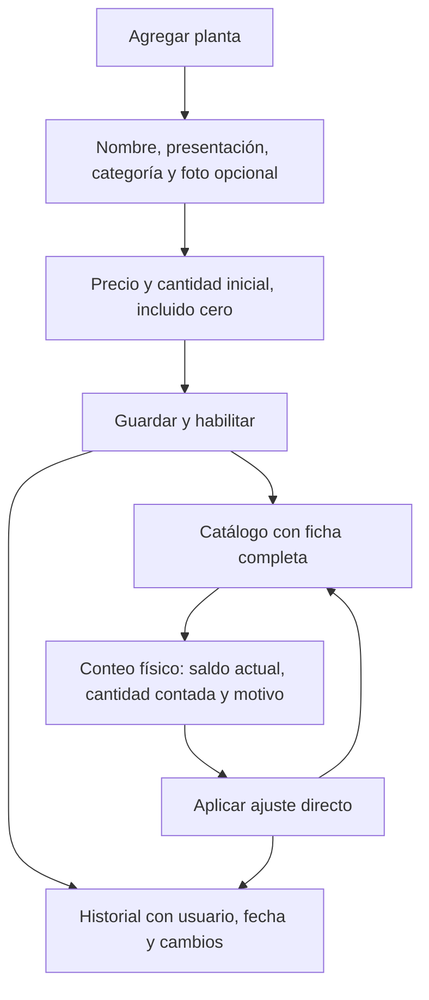

# Registro directo de plantas

Implementación local verificada el 19 de octubre de 2026. Backend y Web publicados
ese día en el VPS Hostinger 2030059; Android queda para ejecución desde Android
Studio en el teléfono de Pedro.

## Comportamiento

OWNER, ADMIN y MANAGER pueden registrar una planta con datos, precio positivo y
cantidad inicial explícita (incluido cero) desde Plantas en Android y Web.
El servidor exige además las capacidades vigentes y una sucursal activa.
Una única confirmación crea la ficha, registra el saldo inicial, habilita la venta
y escribe el historial dentro de la misma transacción. La fotografía es opcional.
Con cero unidades la ficha queda completa, aunque no exista stock para vender.
Se conserva Guardar borrador para información todavía incompleta.

Los conteos directos se realizan desde la ficha de Plantas en Android y desde
Plantas o Existencias y conteos en Web. El servidor rechaza el ajuste si hubo
movimientos posteriores a la consulta del saldo. Los demás roles conservan el
conteo pendiente de revisión. No se aprueban retroactivamente conteos pendientes.

Editar una ficha existente no modifica sus existencias. Las plantas provenientes
de compras conservan la cantidad del documento: no se pide ni se suma otro saldo
inicial. Los reintentos reutilizan la misma clave; nunca crean otro movimiento.

## Contratos

- Migración aditiva `database/mysql/migrations/040_plant_history.sql`.
- `POST /api/v1/plants/confirm`: cantidad inicial opcional en el nivel principal,
  exclusivamente para crear una planta desde un borrador manual sin vinculación.
  Los clientes anteriores pueden omitirla y conservar el flujo anterior.
- `GET /api/v1/inventory/permissions`: `can_apply_count` habilita el nuevo flujo.
- `POST /api/v1/inventory/direct-counts` y `/result`: contrato del conteo existente
  con saldo y movimiento de referencia; autorización y aplicación inmediatas.
- `GET /api/v1/plants/history`: sucursal de sesión, filtro `product_id` y cursor
  `before_id`, 50 registros por página. Android muestra los 50 más recientes;
  Web permite cargar páginas anteriores y filtrar los registros cargados.
- Historial de altas, vinculaciones, cambios de ficha, fotografías y conteos.
  La cuenta API solo puede consultar e insertar; no puede modificar ni borrar.
  Las entradas de compras, ventas y movimientos anteriores mantienen su historial
  operativo existente; esta entrega no unifica todos esos historiales.

El health check exige la migración 040. Android usa la URL HTTPS productiva ya
configurada, pero su instalación en un teléfono físico todavía no se comprobó.

## Publicación en VPS

Pedro solicitó desplegar Web y backend. Se verificó que el único VPS de Hostinger
es el 2030059 (`srv2030059.hstgr.cloud`) y que MariaDB productiva terminaba en
039. El destino fue `/srv/apps/vivero-dulcinea/releases/20261019-plants-direct-acad57fc`.
Se construyeron imágenes nuevas sobre las etiquetas activas previas, conservadas:
`vivero-api-plants:20261019-acad57fc` y
`vivero-web-plants:20261019-c679b28a`. El overlay
`images.direct.yaml` se agregó al final de los archivos Compose originales,
sin mover `current` ni recrear el contenedor MariaDB, el proxy compartido o Catering.

Antes del cambio, el wrapper oficial produjo el respaldo completo
`/var/backups/vivero/vivero-2026-10-20T04-48-33-780Z-b0dd5ebd-eaf8-4600-9f82-ff06cf61dfd3`.
`verify-backup` confirmó hashes de SQL y fotografías. No se ensayó una
restauración aislada de este respaldo nuevo ni una copia externa cifrada.

El migrador aplicó solamente `040_plant_history`. Luego API y Web se recrearon
con `--no-deps --no-build --pull never` y quedaron saludables. Se verificaron
por HTTPS `/health`, `/`, `/admin` y productos con 200; historial y permisos
sin sesión con 401. Los 27 archivos públicos de la Web coincidieron por SHA-256
con el bundle compilado localmente. Catering, su base, el proxy y la base de
Vivero conservaron sus contenedores activos.

Las imágenes anteriores siguen disponibles. Volver a sus referencias exige
revisar el estado operativo antes de cambiar imágenes; 040 es una migración
aditiva y no se revierte al cambiar contenedores.

## Validación ejecutada

- `.\gradlew.bat assembleDebug testDebugUnitTest`: compilación correcta,
  392 pruebas reportadas, 390 aprobadas y 2 omitidas; cero fallos.
- `npm test` en backend: 117 aprobadas.
- `node --test backend/test/cataloging.test.js backend/test/inventory-preparation.test.js`:
  12 aprobadas.
- `backend/scripts/test-cataloging-local.ps1` con MariaDB 11.4.13 temporal:
  30 pruebas aprobadas sobre datos sintéticos. Incluyen los tres roles, cantidad
  cero, reintentos, conteos obsoletos, prohibición a otros roles, historial,
  rollback al fallar el historial y prohibición SQL de UPDATE/DELETE.
- Web: build y lint correctos; 72 pruebas específicas aprobadas.
- `tests/plants-completion-browser.mjs`: recorrido en Chrome con HTTP sintético
  aprobado, confirmación con/sin foto y salida sin descartar; la planta completa
  deja de aparecer en pendientes.
- Verificador estático Supabase: 134 comprobaciones aprobadas. No se modificó
  Supabase; el SQL nuevo se ejecutó y probó en MariaDB local.

No se probó la cámara en un teléfono físico ni se hizo una transacción de
registro con una cuenta real en producción. Las pruebas
de navegador usan respuestas sintéticas; las transacciones y permisos se validan
por separado contra MariaDB real local. No se inició emulador, ni se ejecutó pgTAP
porque esta entrega no modifica PostgreSQL.

## Archivos y trabajo conservado

Backend: `app.js`, `cataloging.js`, `inventory-observations.js`,
`inventory-policy.js`, `plant-edits.js`, nuevo `plant-history.js`; migración 040;
pruebas `auth.test.js` y `cataloging-integration.test.js`.

Android: `BackendApiTransport.kt`, `PlantWork.kt`, `PlantRepository.kt`,
`PlantViewModel.kt`, `PlantScreen.kt`, `PlantRepositoryTest.kt`.
Se conservaron las correcciones previas de fotografías y sus pruebas
`PlantPhotoTransportTest.kt` y `PlantViewModelTest.kt`.

Web: `AdminInventory.tsx`, `InventoryCountReview.tsx`,
`inventory-preparation-service.ts` y sus pruebas; en Plantas:
`AdminPlants.tsx`, `CatalogingWizard.tsx`, `PlantCount.tsx`, `PlantDetail.tsx`,
nuevo `PlantHistory.tsx`, `cataloging-service.ts` y sus pruebas.
Se conservaron `tests/plants-completion-browser.mjs` y
`docs/plants-completion-validation.md` del trabajo previo de confirmación.

Se preservaron sin intervención los cambios preexistentes de `.idea/misc.xml`,
`BackendSalesPolishTest.kt` y `BackendSalesUiTest.kt`. AppCliente no se modificó.
La API y la Web fueron desplegadas en el VPS según la sección anterior;
Android no se instaló allí.
